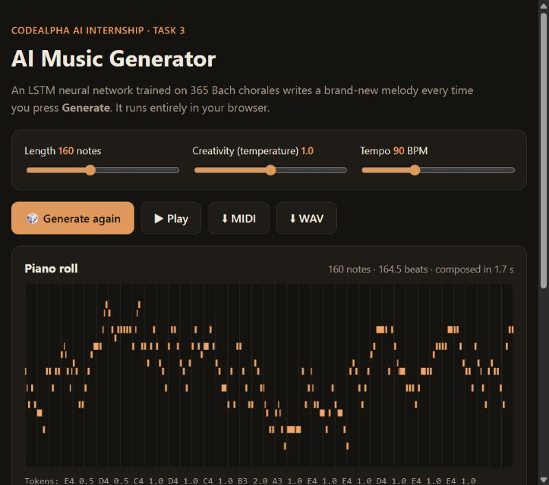
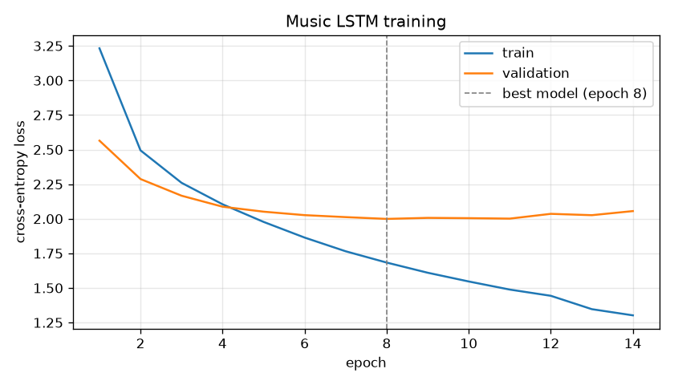

# Music Generation with AI

**CodeAlpha AI Internship — Task 3**

🌐 **Live demo:** https://codealpha-music-ai-sayan.netlify.app — compose a new melody in your browser, play it, and download it as MIDI or WAV.

An LSTM neural network that learns from classical music (Bach chorales) and composes **new melodies**, saved as **MIDI** and **WAV** audio.

🎧 Listen to generated samples: [`output/sample_1.wav`](output/sample_1.wav), [`output/sample_2.wav`](output/sample_2.wav) (MIDI versions next to them).





## Results

| | |
|---|---|
| Training data | 365 Bach chorales (MIDI) → 21,890 note tokens |
| Augmentation | every training melody also transposed ±1 and ±2 semitones (5× data) |
| Vocabulary | 261 distinct note/chord/rest tokens |
| Model | 2-layer LSTM, 256 units, ~980k parameters |
| Training | CPU only, ~40 s per epoch, early stopping after 14 epochs |
| Best model | epoch 8 — validation loss **2.00**, next-note accuracy **44%** (random guessing would be 0.4%) |

The gap between the train and validation curves shows the model starting to memorise after epoch 8; the checkpoint with the lowest validation loss is the one that is kept, and early stopping ends training once it stops improving.

## Pipeline

| Step | Script | What happens |
|---|---|---|
| 1. Collect MIDI data | `prepare_data.py` | Exports the Bach chorales bundled with **music21** to `data/midi/*.mid` (or use your own MIDI files) |
| 2. Preprocess | `prepare_data.py` | Parses each MIDI with **music21**, transposes it to C major / A minor, extracts the melody and turns every note, chord and rest into a token like `E5_1.0` → `data/notes.json` |
| 3. Build the model | `model.py` | **LSTM** network: Embedding → 2-layer LSTM (256 units) → Dropout → Linear |
| 4. Train | `train.py` | Learns to predict the next token from the previous 32 (cross-entropy loss, Adam, transposition augmentation, early stopping, best checkpoint saved) |
| 5. Generate & save | `generate.py` | Starts from a random seed phrase, samples new tokens one by one, converts them to a **MIDI** file and renders a **WAV** file you can play anywhere |

## How it works

**Tokens.** Music is turned into a sequence of "words" the network can learn:

```
G4_1.0   A4_1.0   B4_0.5   C5_0.5   D5_2.0   R_1.0   ...
(note G4 for 1 beat) (A4, 1 beat) ...        (D5, 2 beats) (rest, 1 beat)
```

Chords become `C4.E4.G4_2.0`. Durations are rounded to musical values (1/16 … whole note). Transposing every piece to the same key means the model learns *melodic patterns* instead of memorising keys.

**Model.** An LSTM (Long Short-Term Memory) is a recurrent network with a memory cell, so it can remember what happened several notes ago — useful for rhythm, phrase shape and returning to the home key.

```
tokens ──▶ Embedding(96) ──▶ LSTM(256) ──▶ LSTM(256) ──▶ Dropout ──▶ Linear ──▶ next-token probabilities
```

**Generation.** The model reads a seed phrase, predicts a probability for every possible next token, samples one (with *temperature* and *top-k* to balance creativity and coherence), feeds it back in, and repeats. The result is converted to a music21 stream → MIDI file, and a small NumPy synthesizer (`synth.py`) renders it to WAV.

## Run it

```bash
git clone https://github.com/sayan30082000/CodeAlpha_MusicGeneration.git
cd CodeAlpha_MusicGeneration
python -m venv venv
venv\Scripts\activate          # macOS/Linux: source venv/bin/activate
pip install -r requirements.txt
```

A trained model is included in `models/`, so you can generate music right away:

```bash
python generate.py                         # → output/generated_<time>.mid + .wav
python generate.py --count 3 --play        # 3 pieces, open the last one
python generate.py --temperature 0.7       # safer / more conservative melody
python generate.py --temperature 1.3       # more adventurous
```

To train it yourself:

```bash
python prepare_data.py      # collect + preprocess the MIDI data
python train.py             # train the LSTM (CPU is fine; ~10 minutes)
python generate.py
```

**Use your own music:** put `.mid` files (classical piano, jazz, ...) into `data/midi/` before running `prepare_data.py`. For piano pieces use `python prepare_data.py --part -1` to keep the chords from all hands.

## Live demo (browser version)

Netlify only hosts static files, so the live demo runs the **same trained model** in JavaScript:

- `export_web.py` writes all ~980k LSTM weights to `web/model.bin` (float32) and the vocabulary, layer shapes and 80 Bach seed phrases to `web/model.json`.
- `web/lstm.js` implements the same forward pass as PyTorch (embedding → 2 LSTM layers → linear) and the same temperature / top-k sampling. Checked against PyTorch: identical top prediction at every step, largest logit difference 0.00001.
- `web/app.js` draws a piano roll, plays the melody with the Web Audio API (same harmonic tone as `synth.py`) and exports **MIDI** and **WAV** files.

```bash
python export_web.py      # rebuild web/ after retraining
```

## Project structure

```
CodeAlpha_MusicGeneration/
├── prepare_data.py   # step 1-2: collect MIDI + convert to note tokens
├── music_utils.py    # token <-> music21 conversion helpers
├── model.py          # step 3: LSTM model (PyTorch)
├── train.py          # step 4: training loop, validation, checkpoint, loss chart
├── generate.py       # step 5: sample new music, save MIDI + WAV
├── synth.py          # tiny NumPy synthesizer for WAV output
├── export_web.py     # exports the model for the browser version
├── data/notes.json   # preprocessed training sequences
├── models/           # trained model + training_loss.png
├── output/           # generated MIDI / WAV files
├── web/              # live site (Netlify): lstm.js, app.js, model.bin, model.json
├── netlify.toml      # Netlify settings (publish web/)
└── requirements.txt
```

## Tech stack

Python · PyTorch (LSTM) · music21 · NumPy · SciPy · Matplotlib · JavaScript (Web Audio API) · Netlify
